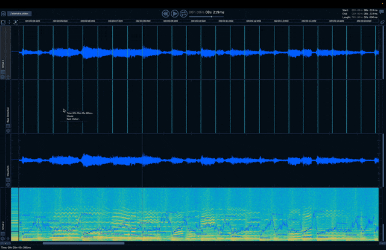

# Partiels

<p align="center">
    <a href="https://github.com/Ircam-Partiels/partiels/actions/workflows/ci.yml"></a>
    <a href="https://github.com/Ircam-Partiels/partiels/releases/latest"></a>
    <a href="https://github.com/Ircam-Partiels/partiels/releases/latest"></a>
    <a href="https://github.com/Ircam-Partiels/Partiels?tab=AGPL-3.0-1-ov-file"></a>
    <a href="https://ircam-partiels.github.io/Partiels/"></a>
</p>

**[Partiels](https://ircam-partiels.github.io/Partiels/)** is a free and open-source software suite for **analysing and exploring the content and characteristics** of sounds.

<p align="center"></p>

## Website

The **[Partiels website](https://ircam-partiels.github.io/Partiels/)** presents the application and gathers all the information for users:

- [Download](https://ircam-partiels.github.io/Partiels/download/) Partiels and the [Vamp plugins](https://ircam-partiels.github.io/Partiels/plugins/)
- [Manual](https://ircam-partiels.github.io/Partiels/manual/)
- [Videos](https://ircam-partiels.github.io/Partiels/resources/videos/) and [publications](https://ircam-partiels.github.io/Partiels/resources/publications/) (with the references to cite Partiels)
- [Support and feedback](https://ircam-partiels.github.io/Partiels/support/)

> For bug reports or feature requests, you can create an [issue](https://github.com/Ircam-Partiels/Partiels/issues) on this Github repository. For more general feedback and questions, you can create a [discussion](https://github.com/orgs/Ircam-Partiels/discussions).

## Compilation

The compilation system is based on [CMake](https://cmake.org/). On macOS, you can use the XCode generator with the command `cmake -G Xcode`. On Windows, you can use the Visual Studio generator with the command `cmake -G "Visual Studio 17 2022"`. On Linux, you can use the Makefile or Ninja generators with the commands `cmake -G "Unix Makefiles"` or `cmake -G Ninja`, using Clang or GCC as the compiler.

Here is an example:

```
git clone --recursive https://github.com/Ircam-Partiels/Partiels.git
cd partiels
cmake . -B build -G Ninja -DCMAKE_BUILD_TYPE=Debug # Example using Ninja generator; use XCode on macOS or Visual Studio on Windows.
cmake --build build
ctest -C Debug -VV --test-dir build # Note: The `-VV` flag is optional and provides verbose output for debugging purposes.
```

> ⚠️ For Linux, JUCE dependencies must be installed: Refer to the file [JUCE/docs/Linux Dependencies.md](<JUCE/docs/Linux Dependencies.md>).

> 💡 You can refer to the [GitHub Actions workflow](.github/workflows/ci.yml) for compilation instructions. 

## Website development

The website is built with [Astro Starlight](https://starlight.astro.build/) from the [Website](Website) directory (Node.js 22.23.4 or higher) and deployed to GitHub Pages by the [Website workflow](.github/workflows/website.yml). The manual and its images are imported from the [Docs](Docs) directory at each build.

```bash
cd Website
npm ci
npm run dev # Local server with live reload, or `npm run build && npm run preview` to check the published version
```

## Release versions

Partiels uses GitHub Actions for continuous integration and automated releases.
The release is created when a new tag is pushed (e.g., `2.1.0`). This is the preferred approach for final stable releases. The CI workflow automatically:
- Builds the project in Release mode
- Creates a draft release with the tag name
- Uploads all platform-specific installers and documentation

```bash
git tag 2.1.0
git push origin 2.1.0
```

### Debug builds

You can manually trigger a debug build from the GitHub Actions UI.

1. Go to the [Actions tab](https://github.com/Ircam-Partiels/Partiels/actions/workflows/ci.yml)
2. Click "Run workflow"
3. Configure the workflow inputs:
   - **Build type**: Choose `Debug` (default `Release`)

> 💡 The CI workflow also automatically detects `[debug]` in commit messages to build in Debug mode for regular commits.

## License

Partiels is distributed under the [GNU Affero General Public License v3](LICENSE) (AGPL-3.0). Unless otherwise stated, this license applies to all source files in this repository; the Git submodules and third-party dependencies remain under their own licenses.

## Credits

**[Partiels](https://github.com/Ircam-Partiels/partiels)**: Design, architecture and development by Pierre Guillot at IRCAM IMR department.  
Copyright 2026 IRCAM.

Contributions by Thomas Barbé, Nolan Dupont, and Guilherme Zanchetta.  

### Dependencies:
- **[Vamp SDK](https://github.com/vamp-plugins/vamp-plugin-sdk)** by Chris Cannam, copyright (c) 2005-2024 Chris Cannam and Centre for Digital Music, Queen Mary, University of London.
- **[Ircam Vamp Extension](https://github.com/Ircam-Partiels/ircam-vamp-extension)** by Pierre Guillot at IRCAM IMR department.  
- **[JUCE](https://juce.com/)** by Raw Material Software Limited.
- **[tinycolormap](https://github.com/yuki-koyama/tinycolormap)** by Yuki Koyama.
- **[JSON C++](https://github.com/nlohmann/json)** by Niels Lohmann.
- **[Magic Enum](https://github.com/Neargye/magic_enum)** by Daniil Goncharov.
- **[ASIO SDK](https://www.steinberg.net/developers/)** by Steinberg Media Technologies GmbH.
- **[llama.cpp](https://github.com/ggml-org/llama.cpp)** by ggml-org organization.
- **[md4c](https://github.com/mity/md4c)** by Martin Mitáš.
- **[hnswlib](https://github.com/nmslib/hnswlib)** by Apoorv Sharma, Abhishek Tayal and Yury Malkov.

### Models (downloaded on demand by Neuralyzer):
- **[Qwen3.5](https://huggingface.co/Qwen/Qwen3.5-9B)** and **[Qwen3.8](https://huggingface.co/Qwen/Qwen3.8-27B)** by Qwen Team, Alibaba Cloud (Apache 2.0), GGUF versions by [Unsloth](https://huggingface.co/unsloth).
- **[BGE-M3](https://huggingface.co/BAAI/bge-m3)** (MIT) and **[BGE Reranker v2 M3](https://huggingface.co/BAAI/bge-reranker-v2-m3)** (Apache 2.0) by BAAI, GGUF versions by [GPUStack](https://huggingface.co/gpustack).
